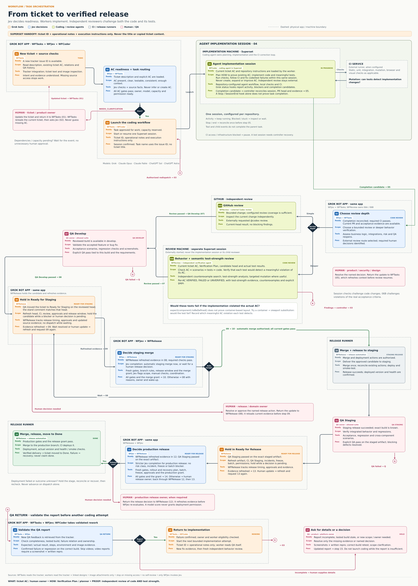

# Approved workflow

[Open the full-size PNG](assets/workflow.png) ·
[Open the scalable SVG](assets/workflow.svg)

## Diagram change rule

Do not edit, regenerate, redraw, rearrange or replace either diagram file unless the
user explicitly requests a diagram change. General repository or instruction updates
do not grant that permission. Preserve its numbering, text, arrows and physical groups.
When another instruction conflicts, report the discrepancy and keep the diagram intact.
This rule also appears in the root [AGENTS.md](../AGENTS.md).

The image is the approved process reference. The instructions below spell out its gates;
they do not create acceptance criteria. Ticket AC, owned by the human/ticket, define WHAT
must work. The Verification Plan defines HOW to prove those existing AC.

## Responsibilities, readiness and transitions

Step numbers are stable diagram references in process order, not ticket status IDs.
Resolve the seven named statuses to real team-specific
tracker IDs; staging release and delivered outcome are operations, not invented statuses.

| Step | Owner and scope | Ready when | Mechanism and acceptance / next step |
| --- | --- | --- | --- |
| 01 — New ticket | WFTasks prepares content for Jev decision requests: current requirements, existing AC, relations and QA history | Exact tracker issue ID exists | The tracker integration, text and image inspection. Check required source access; return sourced evidence without decisions or a mandatory schema. Step 02 independently selects library questions. Sources readable; otherwise stop/report. Proceed to 02 |
| 02 — Readiness and routing | Jev + controller (WFTasks asks through WFJev) check AC, ownership, model and eligibility | Current description and explicit AC loaded | Require present, clear, verifiable, consistent AC and enough context. Never infer AC. Gaps → human updates the ticket → WFTasks 01 rereads → 02. Capacity/dependencies → wait. Ready → 03 |
| 03 — Launch | WFTasks triggers WFCoder to start/resume one Superset session | Work authorized; eligible capacity reserved | Send issue ID + operational notes + execution instructions only. No title or copied ticket content. Confirm session → 04 |
| 04 — Agent implementation session | One repository-configured agent owns planning, implementation and verification | Confirmed session; worker fetched current ticket AC, linked designs and repo instructions | Plan HOW to prove existing AC; implement code/tests; run checks and resolve CI failures internally. Never invent AC or self-review. Hooks report activity/blockers/completion candidates. Controller reconciles the session and current-head evidence before 05 |
| 05 — Review routing | Jev + WFTasks choose depth and identify human decisions; WFTasks hands the route to WFReview | Completion candidate reconciled; current PR and acceptance evidence available; required checks pass | Bounded, sufficiently covered change → 06A; unresolved behavior/integration verification, repo/domain policy or validated QA reopen → 06B; both if required. Missing scope → collect context. Human resolution returns to WFTasks 05 to refresh context |
| 06A — GitHub review | External Codex, requested by WFReview, independently reviews bounded scope | Configured coverage is sufficient | Externally requested `@codex review`. Current-head pass without blockers → 07; findings → controller → 03 |
| 06B — Behavior and test strength | Separate verification agent, started by WFReview, checks AC ↔ scenarios ↔ tests ↔ code | Current AC, plan, head and actual results available | Independent counterexample search, test-strength analysis, targeted mutation where useful. Verify tests detect meaningful AC violations. Per-AC VERIFIED / FAILED / UNVERIFIED. Pass → 07; findings → controller → 03 |
| 07 — QA Develop | QA owner / allowed suite validates accepted behavior | Reviewed build available in develop | Acceptance scenarios, regressions and screenshots. QA moves the ticket to Ready for Staging on the current build → 08; failure → 15. No staging merge decision before that move |
| 08 — Ready for Staging | WFRelease holds the candidate and refreshes evidence | QA moved the ticket to Ready for Staging on the reviewed head; stand comment matches | Refresh head, CI, review threads, branch rules, release window and permissions. Evidence refreshed → 09. Wait resolved or human update → refresh and request 09 again; human decisions return to WFRelease 08 |
| 09 — Staging decision | Jev + controller (WFRelease asks through WFJev) decide automatic staging merge now or wait | WFRelease refreshed evidence in 08 | Jev completion for `merge` plus deterministic gates. All gates and the `merge` grant → 10 directly; otherwise → 08 with reasons/owner/wake-up |
| 10 — Merge and release to staging | WFRelease merges; the release runner delivers the approved candidate | Current gates and each action's authorization pass | Reconcile existing actions, merge once, deploy, confirm actual version and health. Success → 11; failed/unknown outcome → hold/reconcile/recover |
| 11 — QA Staging | QA owner / allowed suite verifies integrated behavior | Successful staging release and exact artifact known | Acceptance, regression and cross-component scenarios. Explicit pass → 12; failure → 15 |
| 12 — Ready for Release (hold) | WFRelease holds the ticket and refreshes evidence on the exact staged artifact | QA Staging passed on the exact staged artifact | Refresh artifact, CI, review, QA Staging, staging release result, batch, rollout/recovery notes, incidents, freeze, timing, approvals and permissions. One ticket cannot authorize a batch containing blocked changes. New head → 05. Evidence refreshed → 13; human update → refresh, then 13 again |
| 13 — Production release decision | Jev + controller (WFRelease asks through WFJev) decide under stricter rules than 09 | WFRelease refreshed evidence in 12 | `step-13` preset for target `deploy_production`: four positive and seven negative predicates, narrower bands, factual gates in code. All gates and the grant → 14. Incident/freeze/pending results → wait under 12; human-reserved risk class or named decision → production release owner → WFRelease 12 → 13 |
| 14 — Merge, release, Done | WFRelease merges to the production branch through the release runner, verifies delivery and moves the ticket to Done | 13 passed on the current artifact; `deploy_production` held | Merge once; when CI deploys on merge, the merge is the production deployment. Verify actual version and health/smoke checks before reporting delivered; then `mark_done` moves the ticket to the configured post-release state. Failure/unknown → recovery, never claim done |
| 15 — QA report validation | WFTasks + Jev (through WFJev) check completeness, build, failure relation and ownership | New QA report fetched from the tracker | Expected/actual, written repro, environment, image evidence. Skip video; any QA video needs a relevant screenshot + written repro. Confirmed actionable failure → 16; incomplete/stale/new-scope/wrong-owner → 17 |
| 16 — Validated rework | WFTasks triggers WFCoder | Failure confirmed; owner/model/worker eligibility checked | Minimal dispatch payload → 03. New fix must receive fresh independent behavior review |
| 17 — Details or decision | QA / product / platform owner supplies missing facts | Report insufficient or decision needed | Update the ticket, retest correct build or resolve ownership/scope. Return to WFTasks 15; no coding while report is insufficient |

Step 04 is one node: planning, implementation and verification are internal activities,
not separately dispatched stages.
A `finished` hook wakes the controller; it does not prove completion or authorize review.
See [session hooks](references/controller.md#session-hooks-and-completion-candidates)
for identity checks, event/action deduplication and recovery.

## Physical and trust boundaries

- **Grok bot app:** WFTasks, WFCoder, WFReview, WFRelease and WFJev. WFTasks uses the tracker
  integration; it does not call or require the design integration. Jev consumes sourced text observations.
  Only WFJev invokes TypeSafe Jev; see [bot roster](references/bot-roster.md).
- **Implementation machine:** Superset runs one agent implementation session (04), configured per repository.
  Workers fetch the ticket and linked designs through their integrations directly. CI may run in an
  external service; its failures remain the coding agent's responsibility.
- **Independent review:** GitHub 06A or externally launched Superset review machine 06B.
  Neither the implementer nor its child can provide the independent review.
- **Release runners and humans:** execute only configured authorized actions; human
  responses return to the responsible WFTasks or WFRelease stage, which refetches sources
  before WFJev asks Jev.

Operational notes and execution instructions must not smuggle ticket details into
Superset's launch metadata. Use the issue ID as the task name. Full internal WFTasks/Jev
evidence is never the host payload. Missing required access stops the responsible session.
Analyze image attachments only; never play, transcribe, extract frames or delegate videos.

Mutation testing inside 04 asks whether tests detect implementation changes. 06B semantic
test-strength review asks whether tests detect violations of the actual AC. A passing
`expect(component).toBeDefined()` does not prove container-based layout. Reviewers must
explain which meaningful AC violation a test detects and record counterexamples and gaps.

## Executable integration contracts

Use [status flows](references/status-flows.md), [controller contract](references/controller.md),
[review routing](references/review-routing.md), [acceptance and verification](references/acceptance-and-verification.md),
[worker signals](references/worker-signals.md) and the [Jev skill](../jev/SKILL.md). Example policies stay in shadow mode; these documents
do not deploy a scheduler or grant merge/release permissions.
